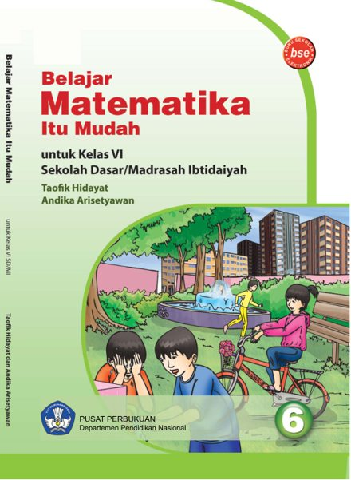

# Belajar Matematika Itu Mudah

Buku matematika untuk **kelas VI SD/MI**, tersedia untuk dibaca secara online oleh publik tanpa login.

**[Baca PDF online](https://github.com/dika-81/belajar--matematika-itu-mudah/blob/main/buku/belajar-matematika-itu-mudah-kelas-6.pdf)** · **[Unduh PDF](https://raw.githubusercontent.com/dika-81/belajar--matematika-itu-mudah/main/buku/belajar-matematika-itu-mudah-kelas-6.pdf)**

## Tentang buku

| Keterangan | Detail |
| --- | --- |
| Judul | Belajar Matematika Itu Mudah |
| Jenjang | Kelas VI Sekolah Dasar / Madrasah Ibtidaiyah |
| Penulis | Taofik Hidayat dan Andika Arisetyawan |
| Penerbit | Pusat Perbukuan, Departemen Pendidikan Nasional |
| Tahun | 2009 |
| Berkas | PDF, 150 halaman, sekitar 5 MB |

Isi PDF dipertahankan seperti berkas sumber. Hak cipta dan atribusi buku tetap mengikuti keterangan dalam buku asli.

## Cara membaca

Klik **Baca PDF online** untuk membuka pembaca PDF GitHub. Jika pratinjau tidak tampil pada perangkatmu, gunakan **Unduh PDF** untuk membuka atau menyimpan berkas dengan pembaca PDF perangkat.

## Halaman web GitHub Pages

Halaman pembaca tambahan sudah disiapkan dalam `index.html`. Untuk mengaktifkannya, buka [Settings → Pages](https://github.com/dika-81/belajar--matematika-itu-mudah/settings/pages), pilih **Deploy from a branch**, branch **main**, folder **/(root)**, lalu klik **Save**.

Setelah GitHub Pages selesai menerbitkan situs, alamatnya adalah `https://dika-81.github.io/belajar--matematika-itu-mudah/`. Tautan PDF di atas tetap dapat digunakan langsung dari repositori publik.
